# Ossetia Work

Сервис поиска работы в Северной Осетии, который целиком живёт внутри Telegram: бот + Mini App.
Соискатели ищут работу и откликаются в два нажатия, работодатели публикуют вакансии и общаются с кандидатами, администратор модерирует всё это и видит статистику.

**Работает в продакшене:** [ossetiawork.ru](https://ossetiawork.ru) · бот [@rabota_alagir_bot](https://t.me/rabota_alagir_bot)

> Скриншоты сняты на демо-данных: компании, люди и вакансии выдуманы.

**Соискатель**

| Лента вакансий | Карточка вакансии | Кабинет |
|:---:|:---:|:---:|
| 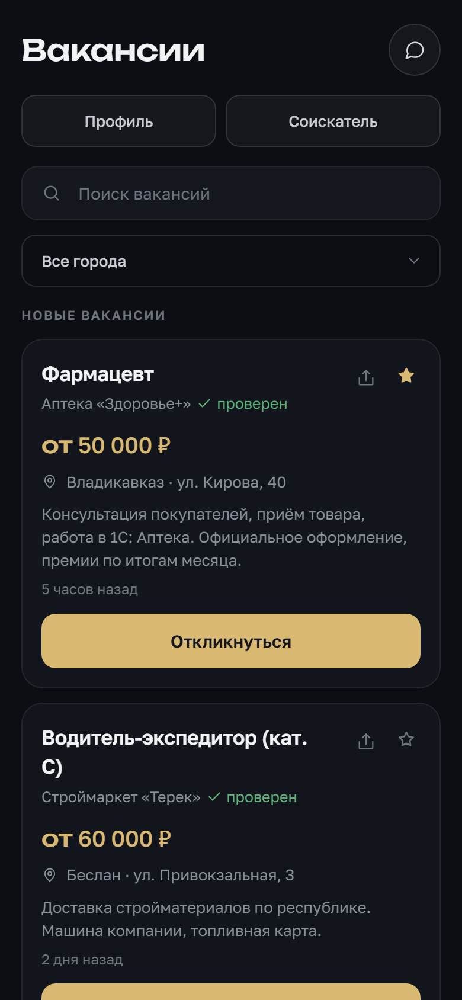 | 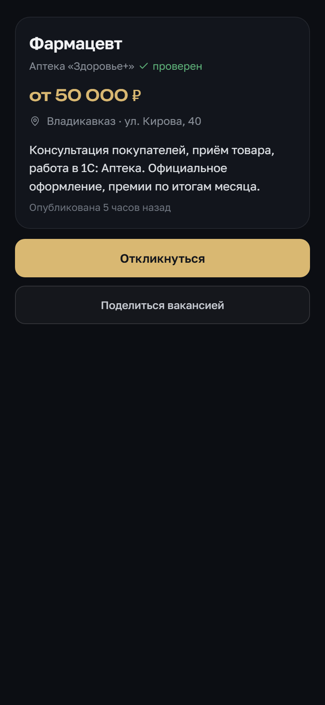 | 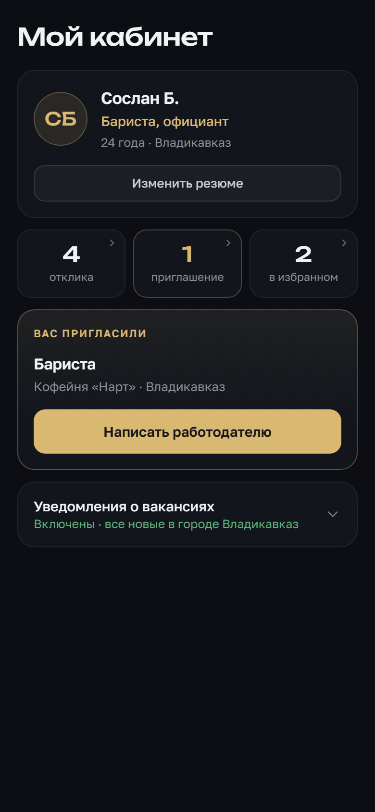 |
| **Мои отклики** | **Переписка с работодателем** | **Избранное** |
| 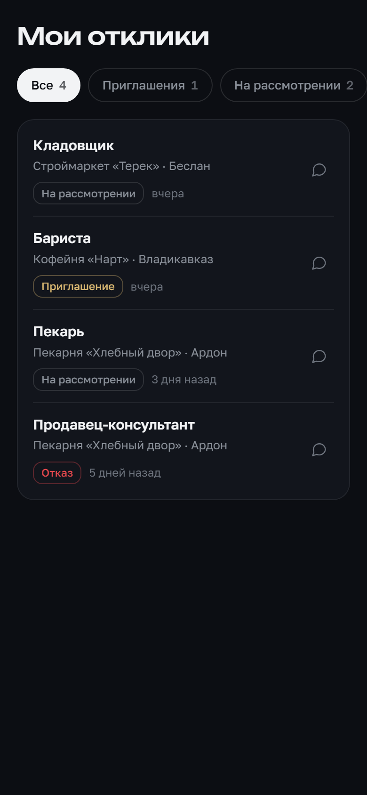 | 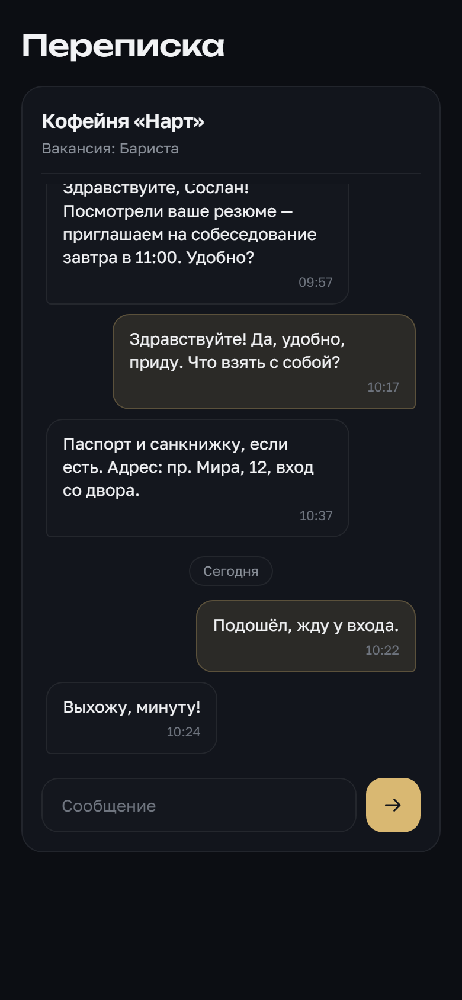 | 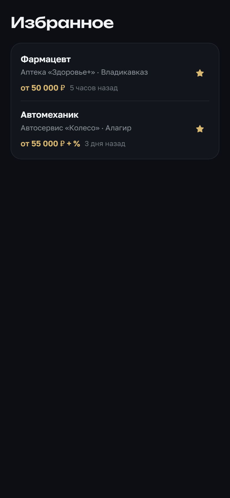 |

**Работодатель и администратор**

| Кабинет работодателя | Мои вакансии | Кандидаты |
|:---:|:---:|:---:|
| 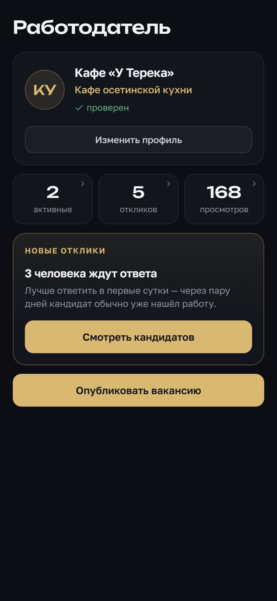 | 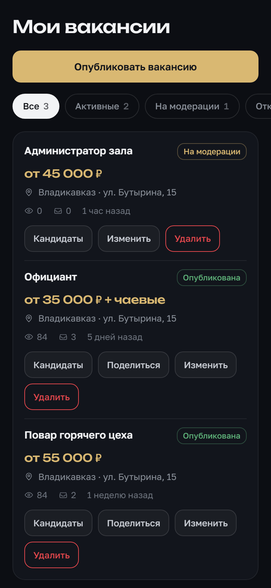 | 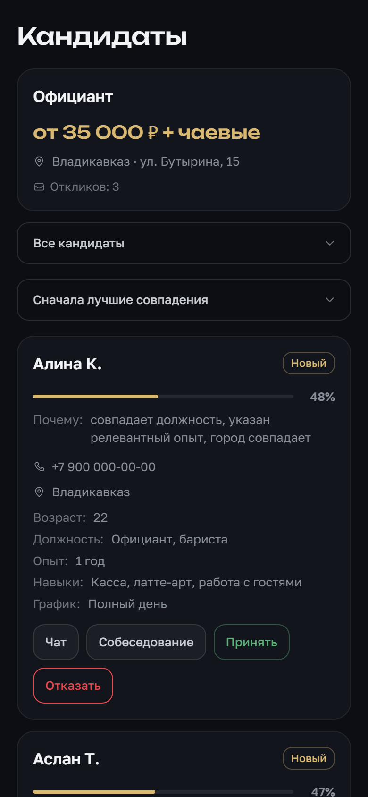 |
| **Вакансия с превью** | **Профиль компании** | **Статистика в админке** |
| 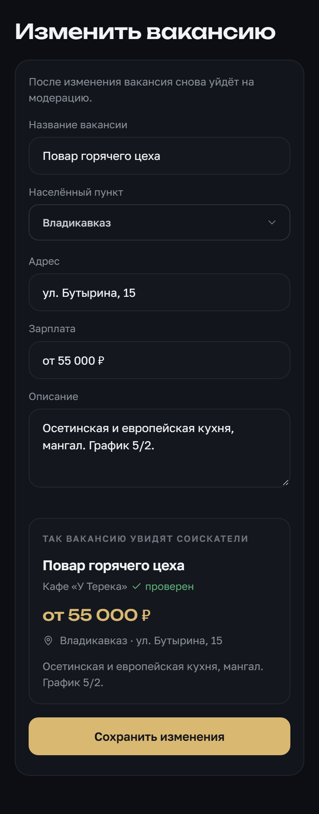 | 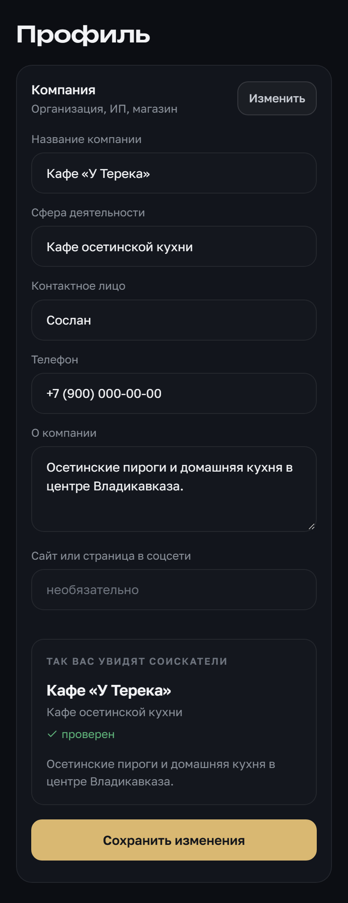 | 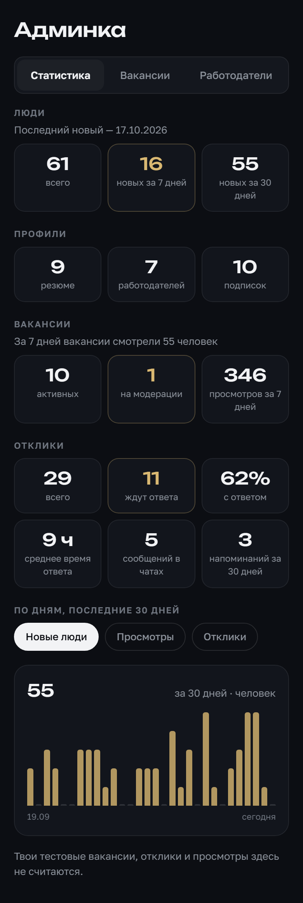 |

## Что умеет

**Соискатель**
- лента вакансий по городам и сёлам республики, поиск, избранное;
- резюме с живым превью; телефон сам форматируется при вводе;
- отклик в одно нажатие и путь отклика: новый → приглашение → принят или отказ с причиной;
- чат с работодателем по каждому отклику: время по часовому поясу телефона, разделители дней, уведомление собеседнику в Telegram;
- уведомления о новых вакансиях в своём городе и по ключевым словам;
- «поделиться вакансией»: ссылка открывает карточку прямо в боте.

**Работодатель**
- профиль компании или частного лица с превью и отметкой «проверен» после модерации;
- публикация и правка вакансий, каждая проходит модерацию;
- список кандидатов с оценкой совпадения резюме и вакансии;
- приглашение, отказ с причиной, чат;
- напоминания об откликах без ответа: один раз на отклик, не чаще раза в сутки и только днём.

**Администратор**
- модерация вакансий и работодателей, временные и постоянные баны;
- статистика: приток людей, просмотры, отклики, доля и скорость ответов, график за 30 дней.

**Бот**
- меню команд, карточка вакансии по ссылке;
- вопросы пользователей вместе с вложениями пересылаются администратору, ответ уходит обратно от имени бота.

## Стек

Python 3.10 · Flask · pyTelegramBotAPI · SQLite (WAL) · HTML, CSS и JavaScript без фреймворков · nginx · systemd · Let's Encrypt · Ubuntu VPS

## Как устроено

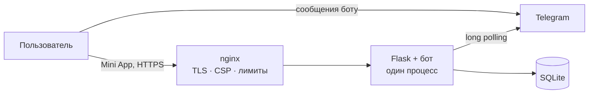

Один процесс: Flask отдаёт страницы Mini App и API, бот работает в отдельном потоке, фоновые задачи (рассылки, напоминания) — в своих потоках.

## Инженерные решения

- **Long polling вместо webhook.** Сервер стоит в российском дата-центре, и входящие соединения от Telegram туда доходят ненадёжно. Polling — это исходящие запросы, они работают всегда. Если поток опроса по любой причине останавливается, процесс завершается и systemd поднимает его заново: бот не может «тихо замолчать», пока сайт продолжает отвечать.
- **Авторизация через initData.** Каждый запрос Mini App несёт подписанные Telegram данные пользователя; сервер проверяет HMAC-подпись и срок давности. Доступ закрыт по умолчанию: без подписи открыты только публичные списки вакансий и городов. Админские маршруты дополнительно проверяют, что запрос пришёл от администратора.
- **Песочница systemd.** Приложение работает от отдельного пользователя без права входа: вся система только для чтения, кроме папки приложения; домашние каталоги не видны; нет привилегий; системные вызовы ограничены. Оценка `systemd-analyze security` — 1.4 (OK).
- **Защита сервера.** nginx отдаёт HSTS, CSP, nosniff и Permissions-Policy, пускает к API не больше 20 запросов в секунду с адреса, а сканерам, которые ищут `.env`, `.git` или WordPress, молча закрывает соединение. fail2ban банит подбор паролей и сканеры, повторным нарушителям — вдвое дольше. SSH только по ключу, firewall пропускает 22/80/443. Конфигурации — в [`deploy/`](deploy/).
- **Секреты не утекают в логи.** Токен бота хранится только в закрытом файле окружения. Telegram принимает токен прямо в адресе запроса, и при сбоях сети библиотека печатает этот адрес целиком — поэтому весь вывод приложения проходит через фильтр, который заменяет токен на `<BOT_TOKEN>`.
- **Уведомления без спама и потерь.** Рассылка идёт в отдельном потоке с журналом доставки, без дублей. Напоминание работодателю не отправляется, если Telegram недоступен, — отклик остаётся в очереди до следующей попытки.
- **Честная статистика.** Просмотры работодателем собственных вакансий и действия администратора не попадают в счётчики; откликнуться на свою вакансию сервер не даст.
- **Схема базы мигрирует сама.** При запуске приложение досоздаёт недостающие таблицы и колонки, поэтому одна и та же версия кода работает и на новой, и на старой базе.
- **Интерфейс без фреймворков.** Единая дизайн-система на CSS-переменных, нативные кнопки и вибрация Telegram, плавные переходы между страницами (View Transitions API), поддержка `prefers-reduced-motion`.

## Структура

```
main.py                   сервер: API, страницы, бот, фоновые задачи, миграции
templates/                15 страниц Mini App
static/css/app.css        дизайн-система
static/js/webapp_nav.js   обёртка над Telegram WebApp API: кнопки, навигация, вибрация, запросы
static/fonts/             Golos Text и Unbounded (локально, без внешних CDN)
deploy/                   systemd, nginx, fail2ban, SSH, бэкапы — как на продакшене
```

## Запуск у себя

1. Создайте бота у [@BotFather](https://t.me/BotFather) и получите токен.
2. Mini App открывается только по HTTPS. Нужен домен с сертификатом или туннель к локальному порту 5000 (например, `cloudflared` или `ngrok`).
3. Установите и запустите:

```bash
git clone https://github.com/khachegemov-bot/ossetiawork.git
cd ossetiawork
python3 -m pip install -r requirements.txt
cp .env.example .env        # впишите токен, свой Telegram ID и HTTPS-адрес Mini App
set -a; . ./.env; set +a
python3 main.py
```

База SQLite создаётся автоматически при первом запуске.

4. В @BotFather, в настройках бота (Bot Settings), укажите этот же HTTPS-адрес как адрес Mini App.

## Развёртывание

В [`deploy/`](deploy/) лежат рабочие конфигурации продакшена, адреса заменены заглушками:
- юнит systemd с песочницей;
- nginx с заголовками безопасности и лимитами;
- fail2ban и фильтр для сканеров;
- настройки SSH;
- скрипты бэкапов: ежедневная копия базы на сервере и еженедельная — в Telegram.

## О проекте

Проект сделан одним человеком — от идеи и дизайна до настройки сервера. В разработке помогал ИИ-ассистент Claude Code.

## Лицензия

Код открыт для ознакомления. Все права защищены: копирование и использование без разрешения автора не допускается.

Шрифты Golos Text и Unbounded распространяются по лицензии SIL Open Font License 1.1 — тексты лицензий лежат в `static/fonts/`.
